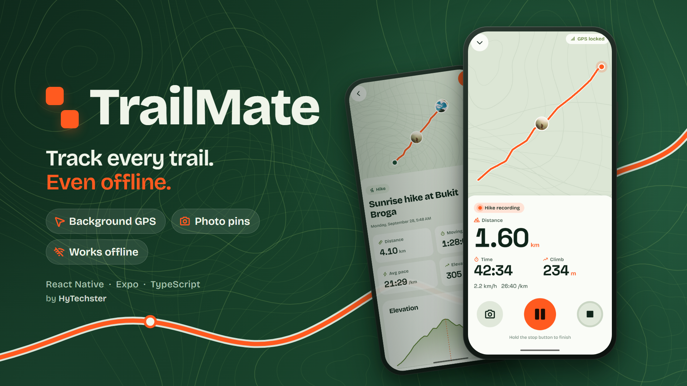
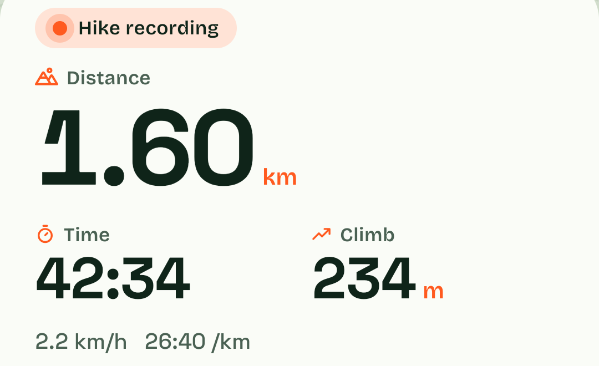
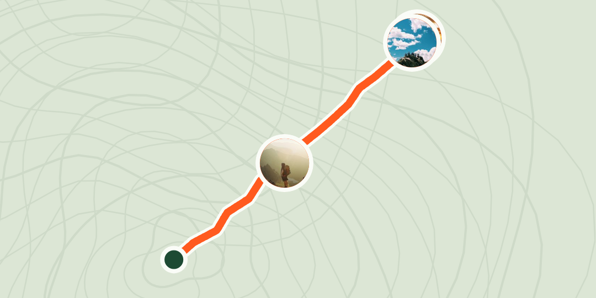
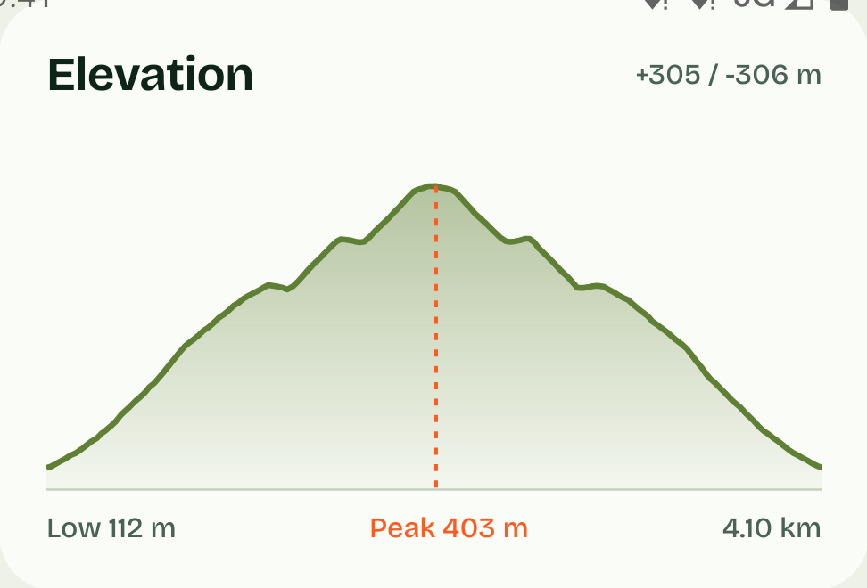
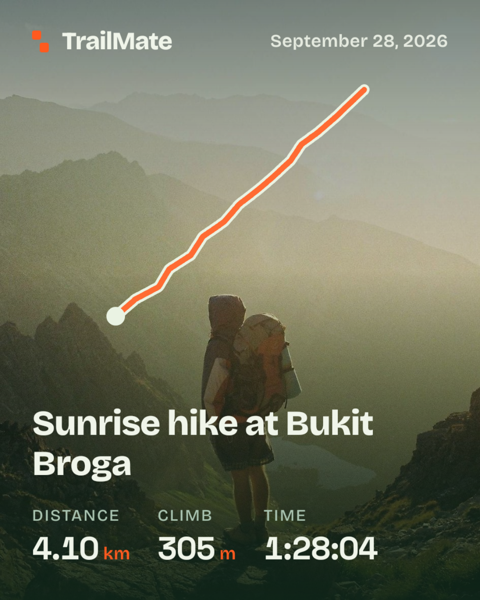
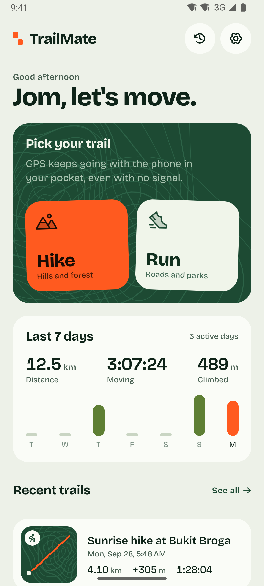
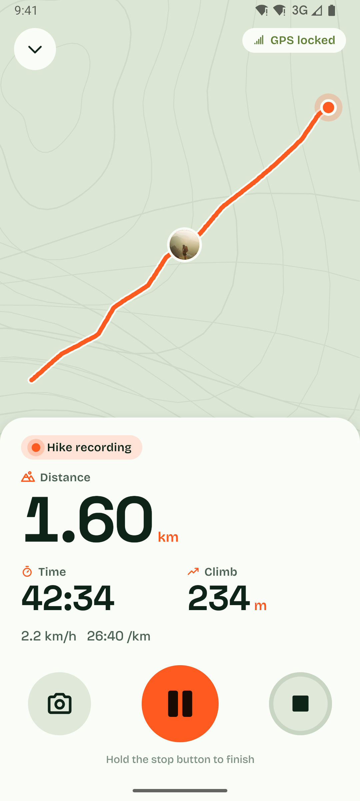
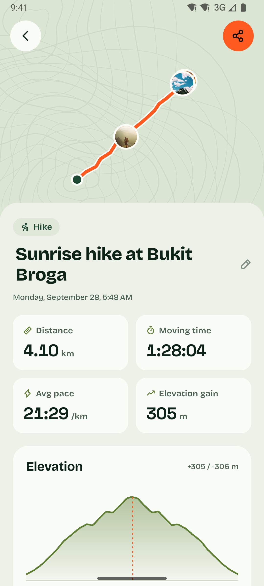
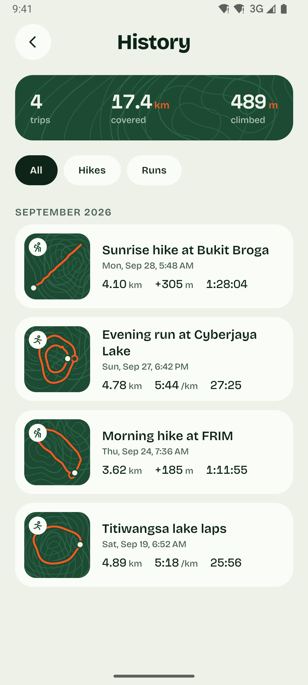
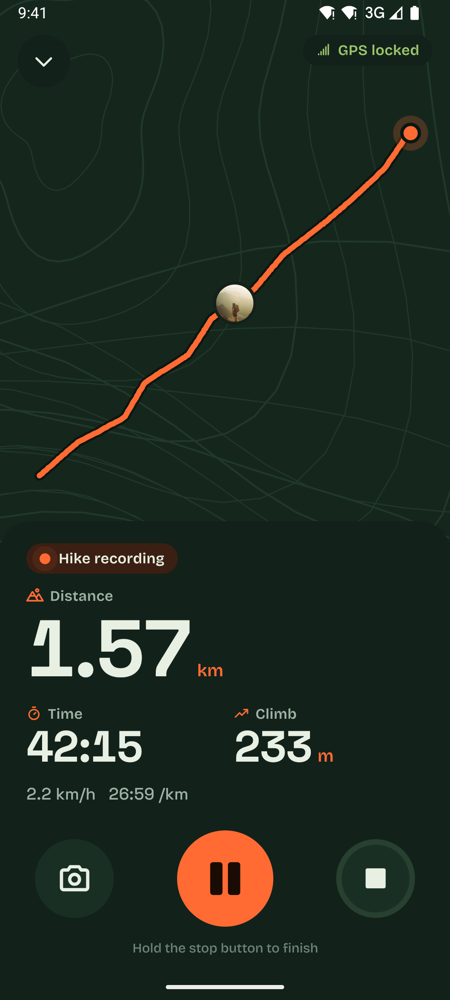

<p align="center">
  
</p>

<p align="center">
  <b>A hiking and running tracker that records your route with the phone locked in your pocket, and works with zero signal.</b>
</p>

<p align="center">
  
  
  
  
  
</p>

---

## Features

<table>
  <tr>
    <td width="58%">
      <h3>Background GPS</h3>
      Start a hike or run, lock the phone, put it away. A background task writes every fix straight to SQLite, so
      the route keeps growing with no screen on. If the app gets killed, the next launch offers <b>Resume</b> or <b>Finish</b>.
    </td>
    <td align="center"></td>
  </tr>
  <tr>
    <td align="center"></td>
    <td>
      <h3>Photos pinned to the trail</h3>
      Tap the camera mid-hike. The photo is pinned to your latest GPS point (not EXIF), copied into app storage,
      and shows up as a marker. Tap it to see when and how far in you took it.
    </td>
  </tr>
  <tr>
    <td>
      <h3>Works fully offline</h3>
      Tracking, stats, photos, history and sharing need no internet. Bukit Broga at 5am has no signal, and that's fine.
      With no map tiles cached, the route still draws on a topo background.
    </td>
    <td align="center"></td>
  </tr>
  <tr>
    <td align="center"></td>
    <td>
      <h3>Share card</h3>
      Finish and get a 1080x1350 card with your route shape, stats and best photo. One tap opens the share menu for
      WhatsApp or Instagram. Drawn with SVG, so it works offline too.
    </td>
  </tr>
</table>

Plus: honest elevation gain (no fake climbing on flat ground), km splits, haptics you can feel in a pocket, a
long-press stop so it never ends by accident, light and dark mode, and big numbers you can read in the sun.

## Screenshots

<p align="center">
  
  &nbsp;
  
  &nbsp;
  
</p>

<p align="center">
  
  &nbsp;&nbsp;
  
</p>

<p align="center">
  
  &nbsp;
  
  <br />
  <sub>Light and dark. The record screen shows at most three big stats, readable at arm's length.</sub>
</p>

## Why React Native

Everything that makes this app worth building is on the device: background location, the camera, local storage,
the native share sheet and haptics. Expo gives all of these as maintained modules (`expo-location` +
`expo-task-manager`, `expo-image-picker`, `expo-sqlite`, `expo-sharing`, `expo-haptics`) with one TypeScript
codebase for iOS and Android. A web app can't record GPS with the screen locked, and two native apps would be
twice the work for the same features.

## How it works

**Background task.** `TaskManager.defineTask` lives in `src/tracking/locationTask.ts` and is imported at the very
top of the app entry, so the OS can wake it with no screen mounted. It never touches React state: it writes points
to SQLite, and the record screen reads them back every 1.5 s. On Android it runs as a foreground service with a
"TrailMate is recording your hike" notification; on iOS it uses the `Fitness` activity type with the blue
location indicator. Pausing ends a segment, and distance never joins across segments.

**GPS filtering.** Phones lie a little. Fixes worse than 25 m accuracy are dropped, and so is any jump that implies
an impossible speed (over 3 m/s on a hike, 8 m/s on a run). If five fixes in a row look impossible, the filter
decides the *last good point* was the bad one and re-anchors instead of throwing away the rest of your hike.

**Elevation smoothing.** Raw GPS altitude wobbles a few metres even when you stand still, which adds up to fake
climbing. TrailMate smooths altitude with a 5-point moving average, then only counts a climb or descent once it
moves more than 3 m from the last turning point (hysteresis). Walking round a flat lake adds 0 m, not 60.

All the maths is pure TypeScript in `src/geo` with unit tests built from small hand-made routes where the right
answer is known.

## Run it locally

Background location needs native code, so TrailMate runs as a **development build**. It does not work in Expo Go.

### What you need

| | |
|---|---|
| Node | 20.19+, 22.13+ or 24.3+ |
| Android | [Android Studio](https://developer.android.com/studio) with SDK 36 and an emulator, or a phone with USB debugging on. Android Studio's bundled JDK is fine. |
| iOS | A Mac with Xcode 16+ (iOS builds don't work on Windows or Linux) |

### First run

```bash
git clone <this repo> && cd trailmate
npm install
npm run android        # builds, installs and opens the app (first build takes about 8 min)
# or: npm run ios
```

`npm run android` generates the native `android/` folder from `app.json`, builds it, installs the app on the
running emulator or plugged-in phone, and starts Metro. Keep that terminal open.

### Day to day

Rebuild only after adding a package with native code or changing `app.json`. Otherwise:

```bash
npm start              # start Metro, then open TrailMate on the device
npm test               # geo maths tests
npx tsc --noEmit       # type check
```

- **Real phone:** turn on Developer options (tap *Build number* 7 times), enable *USB debugging*, plug in, then
  `npm run android`.
- **Fake GPS:** emulator **⋯** > Location > Routes, or iOS Simulator > Features > Location.
- **Demo data:** in a dev build, long-press the version line at the bottom of Settings.
- Always test tracking on a real phone, outdoors, with the screen locked.

### Install on your phone (standalone APK)

A release APK has all the code inside, so it runs anywhere with no PC or Metro. Use this for real hikes.

```bash
npx expo prebuild --platform android    # only if the android/ folder is missing
cd android
./gradlew assembleRelease -PreactNativeArchitectures=arm64-v8a
```

The APK lands in `android/app/build/outputs/apk/release/app-release.apk`. Copy it to the phone (USB, Drive or
chat app), open it, allow *Install unknown apps* for that source, then install. If Play Protect warns, choose
*More details > Install anyway*.

- `arm64-v8a` covers nearly every phone from the last 7+ years. Leave the flag off to build every CPU type
  (bigger file, needed for very old 32-bit phones).
- This APK is signed with the debug key. That's fine for your own phone and friends, but the Play Store needs your
  own upload key.
- An `arm64-v8a` APK won't start on the x86_64 Android emulator. Build with `-PreactNativeArchitectures=x86_64`
  to test a release build there.

### Google Maps (optional)

iOS uses Apple Maps and needs nothing. On Android, TrailMate uses Google Maps if you give it a key. Without a key,
the app still works: it draws routes on its own offline topo background (that's what the screenshots show).

1. Open the [Google Cloud Console](https://console.cloud.google.com/) and create a project.
2. Link a billing account. Google asks for one even for free usage. Showing maps in a mobile app with the
   Maps SDK has had no usage charge, but check the current
   [pricing](https://mapsplatform.google.com/pricing/) and set a small budget alert to be safe.
3. **APIs & Services > Library**, then find **Maps SDK for Android** and enable it.
4. **APIs & Services > Credentials > Create credentials > API key.**
5. Restrict the key so it's useless to anyone who copies it from your APK:
   - *Application restrictions:* **Android apps**, package `com.trailmate.app`, plus your SHA-1. Get the SHA-1
     with `cd android && ./gradlew signingReport` (use the `Variant: debug` line; add your release SHA-1 later).
   - *API restrictions:* only **Maps SDK for Android**.
6. Copy `.env.example` to `.env` and paste the key:
   ```
   GOOGLE_MAPS_ANDROID_KEY=AIza...
   ```
   `.env` is git-ignored. Never commit it.
7. Rebuild so the key goes into the native project:
   ```bash
   npx expo prebuild --clean
   npm run android
   ```

A grey map with only a Google logo means the key is wrong or restricted to a different SHA-1 or package.

### Compatibility

| Platform | Supported | Notes |
|---|---|---|
| Android | 7.0 (API 24) to 16 (API 36) | Tested on Android 10 and Android 16 emulators |
| iOS | 16.4+ | |

The app handles the version differences itself:

- **Android 10+:** "Allow all the time" is its own permission. TrailMate explains it first and still records if
  it's denied (screen kept on).
- **Android 12+ / iOS 14+:** approximate location is too rough for a route, so TrailMate asks for precise location
  before starting.
- **Android 13+:** asks for notification permission so the "TrailMate is recording" notification is visible.
- **Android 14+:** uses a `location` type foreground service, started while the app is open.

### Troubleshooting

- **Red "Unable to load script" screen:** the app opened before Metro was ready. Run `npm start`, then press Reload.
- **Recording stops with the phone locked on Xiaomi, Huawei, Oppo, Vivo or Samsung:** these phones kill
  background apps harder than stock Android. Set TrailMate's battery setting to *Unrestricted* (or *No
  restrictions*). [dontkillmyapp.com](https://dontkillmyapp.com/) has steps per brand.
- **No route drawn:** check that location is on and TrailMate has **precise** location.
- **Build errors after pulling changes:** `npx expo prebuild --clean`, then `npm run android` again.

### Cover image

`docs/thumbnail.png` is built from `docs/thumbnail/thumbnail.html` and the screenshots:

```bash
npx playwright install chromium   # once
npm run thumbnail
```

## Project structure

```
app/                 expo-router screens: home, record, summary/[id], history, settings
src/tracking/        background task, start/pause/resume/stop, permissions
src/db/              SQLite schema (migrations by user_version) and all queries
src/geo/             distance, filtering, elevation, pace (pure, tested)
src/photos/          camera + file storage
src/share/           the 1080x1350 summary card and share flow
src/components/      RouteMap, ElevationChart, HoldButton, StatTile...
src/theme/tokens.ts  colours, spacing, radius, type scale
docs/thumbnail/      HTML source + Playwright export for the cover image
```

## Roadmap

- Offline map downloads with MapLibre offline packs for chosen trails
- GPX export and import
- Auto-pause when stopped
- Voice updates every km
- Home screen widget / live activity showing the current recording

## License

[MIT](LICENSE) © 2026 HyTechster. Use it, learn from it, build on it; just keep the copyright notice.

The demo photos in `assets/demo/` are from [Unsplash](https://unsplash.com/license) via Lorem Picsum and fall
under the Unsplash License, not MIT. The demo routes are synthetic.
